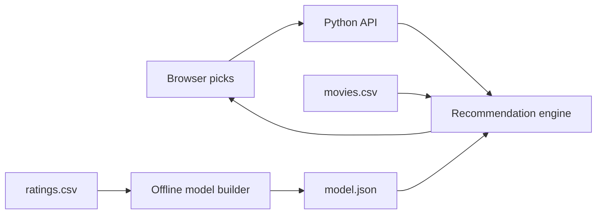

# PickMyMovie

An explainable movie recommendation web app. Pick films you liked and get a fresh shortlist immediately, with a reason for each result. Built as a compact full stack portfolio project: responsive browser UI, Python HTTP API, data ingestion, a hybrid recommendation model, and automated tests.


## Quick start

No package installation or API key is needed.

```powershell
python app.py
```

Open [http://localhost:8000](http://localhost:8000). Search for a film, add it to your picks, and see recommendations update. Picks stay in your browser's local storage.

On macOS/Linux, run the same `python app.py` command (or `python3 app.py`). The server binds to `127.0.0.1` by default.

## Dataset and reproducibility

Source: [Movie Recommendation System by Manas Parashar on Kaggle](https://www.kaggle.com/datasets/parasharmanas/movie-recommendation-system). The downloaded `movies.csv` has 62,423 rows (`movieId,title,genres`); movie IDs extend above 200,000 but are not a row count. The companion `ratings.csv` contains `userId,movieId,rating,timestamp`. This repository includes the full movie catalog and a generated compact ratings model. The 678 MB uncompressed `ratings.csv` is excluded from Git and deployment. See [data/DATA_LICENSE.md](data/DATA_LICENSE.md) for attribution and data license details.

To reproduce or refresh the model:

1. Download the dataset from Kaggle and unzip it.
2. Replace `data/movies.csv` with the downloaded copy.
3. Put `ratings.csv` in `data/` and run `python build_model.py`. This rebuilds `data/model.json` with rating summaries and top item neighbors. Restart the server to load it.

The ratings build streams the CSV twice and keeps only pair counts for the 1,500 most rated movies. It assumes `ratings.csv` is sorted by `userId` (the common MovieLens layout). The catalog alone works without ratings; its recommendations are based on genre similarity.



## How recommendations work

The live request sends at most 30 liked movie IDs to `GET /api/recommendations`. For each genre, the engine applies an inverse frequency weight, so a less common genre tells us more than a ubiquitous one. It builds a profile from the liked films and scores candidate movies with cosine similarity. An inverted genre index limits each request to relevant candidates. Already liked films are excluded.

When `model.json` exists, validation selects a 25% genre / 75% collaborative personalization blend; that blend receives 97% of the final score and a confidence-weighted rating-quality term receives 3%. The offline build treats ratings of 4 or higher as likes, restricts item pairs to the 1,500 most-observed movies, caps each user's contribution at their 20 most recent likes, applies support shrinkage, and saves up to 35 neighbors per movie. A genre-overlap penalty diversifies the final shortlist.

**Honest limitations:** The catalog metadata does not include plots or posters. The collaborative model is trained on historical ratings, not live user feedback; “real time” means the shortlist recomputes whenever the visitor changes their picks. New or rare movies have less collaborative coverage. The snapshot ends in 2019 and does not supply current releases. Offline implicit-feedback metrics do not prove user satisfaction.

## Offline evaluation

`evaluate.py` performs a leakage-resistant temporal evaluation. For each eligible user, the latest positive rating is the test target, the second latest is validation, and earlier interactions are training data. It compares popularity, genre-content, collaborative, and hybrid ranking; selects the hybrid blend on validation NDCG; and records held-out Recall@10, NDCG@10, MRR@10, catalog coverage, and measured ranking latency.

The committed `evaluation/results.json` records the exact protocol, sample sizes, candidate universe, random seed, and results. Reproduce the reported run after downloading `ratings.csv`:

```powershell
python evaluate.py
```

With one held-out target per user, Recall@10 is equivalent to hit rate. Results apply only to the recorded sample and candidate universe; do not generalize them to every catalog item or future user.

The committed run scanned 10,000 users and evaluated a deterministic sample of 1,000 within the 5,000 most-observed candidate movies:

| Strategy | Recall@10 | NDCG@10 | MRR@10 | Coverage@10 | Mean offline latency |
| --- | ---: | ---: | ---: | ---: | ---: |
| Popularity | 5.0% | 0.0230 | 0.0149 | 0.28% | 0.3 ms |
| Genre content | 1.2% | 0.0060 | 0.0042 | 34.14% | 22.2 ms |
| Collaborative | 9.3% | 0.0431 | 0.0284 | 18.70% | 0.3 ms |
| Validation-selected hybrid + diversity | 8.9% | 0.0414 | 0.0272 | 20.18% | 37.9 ms |

The collaborative model had the strongest held-out relevance in this run. The selected hybrid was retained because validation chose its 25% content blend and it broadened test catalog coverage, but the relevance tradeoff is reported rather than hidden.

## API

| Endpoint | Purpose |
| --- | --- |
| `GET /api/health` | Catalog size, data mode, collaborative model availability |
| `GET /api/movies?q=heat` | Title search, maximum 12 matches |
| `GET /api/genres` | Available genre filters |
| `GET /api/recommendations?liked=1,2&genre=Adventure&limit=12` | Ranked suggestions with score and explanation |

Invalid numeric inputs return HTTP 400. The API is local by default and does not store visitor picks on a server.

## Development

```powershell
python -m unittest discover -s tests -v
python -m py_compile app.py recommender.py build_model.py evaluate.py
node --check public/app.js
```

Run `python evaluate.py` only when the local `data/ratings.csv` is present; the documented 10,000-user evaluation takes several minutes.

For a containerized run, use `docker build -t pickmymovie .` and `docker run --rm -p 8000:8000 pickmymovie`. The image includes the catalog and compact model, while `.dockerignore` excludes the raw ratings. GitHub Actions runs syntax checks and unit tests on each push and pull request.

### Hosting on your domain

This repository is prepared as a separate Vercel project. The `public/` directory is served through Vercel's CDN and `api/*.py` provides Python Functions for the four API endpoints. `.vercelignore` excludes raw ratings. Keeping PickMyMovie in its own repository lets it deploy independently from the Next.js portfolio at `samirrajani.com`.

1. After review and approval, commit and push the existing `Pick-My-Movie` repository.
2. Redeploy its existing Vercel project with the repository root as the project root; `vercel.json` supplies function exclusions and security headers.
3. Test the stable `vercel.app` URL: `/`, `/styles.css`, `/app.js`, all four `/api/*` endpoints, and confirm `/api/health` reports `modelSchema: 2`.
4. Deploy the Personal Website repository only after step 3 passes. Its external rewrite exposes the app at `samirrajani.com/pick-my-movie`.
5. Verify the legacy `/pickmymovie` redirect, the case study, sitemap, search, recommendations, genre filtering, and 320px layout on production.

The deployment and DNS steps require access to the GitHub, Vercel, and DNS accounts. They have not been performed by this repository setup.

### Project structure

```text
app.py                 HTTP server and JSON API
recommender.py         Catalog loading, search, ranking, explanations
build_model.py         Streaming offline ratings model build
evaluate.py            Temporal holdout evaluation and baselines
public/                Accessible responsive interface
data/movies.csv        Full movie catalog, tracked for deployment
data/model.json        Compact ratings model, tracked for deployment
data/demo_movies.csv   Fallback catalog
api/                   Vercel Python Functions
tests/                 Core behavior checks
evaluation/results.json Reproducible measured results
```

### Design decisions and next steps

- A standard library server makes the demo easy to run locally; production requests use Vercel Python Functions.
- The UI stores favorites locally to avoid adding accounts before they are needed. Multi-device sync would require authentication and a database.
- A useful next experiment is repeating the temporal protocol across multiple deterministic samples and reporting confidence intervals.
- A public demo should add a licensed artwork source only after checking attribution, usage rights, and API limits.

## Attribution

Movie metadata in `data/demo_movies.csv` comes from the [Kaggle dataset by Manas Parashar](https://www.kaggle.com/datasets/parasharmanas/movie-recommendation-system), which identifies the movie data as MovieLens and lists an ODbL 1.0 license. The app code and visual design are original to this repository. No résumé or personal contact information is included in the app or source data.
