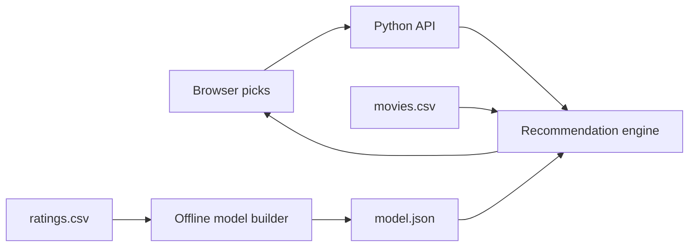

# PickMyMovie

An explainable movie recommendation web app. Pick films you liked and get a fresh shortlist immediately, with a reason for each result. Built as a compact full stack portfolio project: responsive browser UI, Python HTTP API, data ingestion, a hybrid recommendation model, and automated tests.


## Quick start

No package installation or API key is needed.

```powershell
python app.py
```

Open [http://localhost:8000](http://localhost:8000). Search for a film, add it to your picks, and see recommendations update. Picks stay in your browser's local storage.

On macOS/Linux, run the same `python app.py` command (or `python3 app.py`). The server binds to `127.0.0.1` by default.

## Dataset and reproducibility

Source: [Movie Recommendation System by Manas Parashar on Kaggle](https://www.kaggle.com/datasets/parasharmanas/movie-recommendation-system). The downloaded `movies.csv` has 62,423 rows (`movieId,title,genres`); movie IDs extend above 200,000 but are not a row count. The companion `ratings.csv` contains `userId,movieId,rating,timestamp`. This repository includes the full movie catalog and a generated compact ratings model. The 678 MB uncompressed `ratings.csv` is excluded from Git and deployment. See [data/DATA_LICENSE.md](data/DATA_LICENSE.md) for attribution and data license details.

To reproduce or refresh the model:

1. Download the dataset from Kaggle and unzip it.
2. Replace `data/movies.csv` with the downloaded copy.
3. Put `ratings.csv` in `data/` and run `python build_model.py`. This rebuilds `data/model.json` with rating summaries and top item neighbors. Restart the server to load it.

The ratings build streams the CSV twice and keeps only pair counts for the 1,500 most rated movies. It assumes `ratings.csv` is sorted by `userId` (the common MovieLens layout). The catalog alone works without ratings; its recommendations are based on genre similarity.



## How recommendations work

The live request sends at most 30 liked movie IDs to `GET /api/recommendations`. For each genre, the engine applies an inverse frequency weight, so a less common genre tells us more than a ubiquitous one. It builds a profile from the liked films and scores candidate movies with cosine similarity. An inverted genre index limits each request to relevant candidates. Already liked films are excluded.

When `model.json` exists, the score combines genre similarity (69%), item co-like cosine similarity (26%), and a small confidence weighted rating quality term (5%). The offline build treats ratings of 4 or higher as likes, restricts item pairs to popular movies, caps each user's contribution at 20 liked films, and saves up to 35 neighbors per movie. These are practical engineering choices, not tuned hyperparameters or claims of measured accuracy.

**Honest limitations:** The catalog metadata does not include plots or posters. The collaborative model is trained on historical ratings, not live user feedback; “real time” means the shortlist recomputes whenever the visitor changes their picks. New or rare movies have less collaborative coverage. The Kaggle snapshot is static and does not supply current releases. The ranking weights have not yet been validated through an offline evaluation.

## API

| Endpoint | Purpose |
| --- | --- |
| `GET /api/health` | Catalog size, data mode, collaborative model availability |
| `GET /api/movies?q=heat` | Title search, maximum 12 matches |
| `GET /api/genres` | Available genre filters |
| `GET /api/recommendations?liked=1,2&genre=Adventure&limit=12` | Ranked suggestions with score and explanation |

Invalid numeric inputs return HTTP 400. The API is local by default and does not store visitor picks on a server.

## Development

```powershell
python -m unittest discover -s tests -v
```

For a containerized run, use `docker build -t pickmymovie .` and `docker run --rm -p 8000:8000 pickmymovie`. The image includes the catalog and compact model, while `.dockerignore` excludes the raw ratings. GitHub Actions runs syntax checks and unit tests on each push and pull request.

### Hosting on your domain

This repository is prepared as a separate Vercel project. The `web/` directory is the static output and `api/*.py` provides Python Functions for the four API endpoints. `vercel.json` selects the static output directory, and `.vercelignore` excludes raw ratings. Keeping PickMyMovie in its own repository lets it deploy independently from the Next.js portfolio at `samirrajani.com`.

1. Push this folder to a new GitHub repository named `PickMyMovie`.
2. In Vercel, import that repository as a new project. Keep the project root at the repository root; `vercel.json` provides the build settings.
3. Test the assigned `vercel.app` URL: search for a film, add it, confirm recommendations, and check `/api/health` reports the full catalog and collaborative model.
4. Add `pickmymovie.samirrajani.com` to the new Vercel project's Domains settings. Configure the exact CNAME record Vercel displays. This does not move or replace the existing `samirrajani.com` portfolio.
5. Add a project card on the portfolio linking to the new subdomain and the PickMyMovie GitHub repository.

The deployment and DNS steps require access to the GitHub, Vercel, and DNS accounts. They have not been performed by this repository setup.

### Project structure

```text
app.py                 HTTP server and JSON API
recommender.py         Catalog loading, search, ranking, explanations
build_model.py         Streaming offline ratings model build
web/                   Accessible responsive interface
data/movies.csv        Full movie catalog, tracked for deployment
data/model.json        Compact ratings model, tracked for deployment
data/demo_movies.csv   Fallback catalog
api/                   Vercel Python Functions
tests/                 Core behavior checks
```

### Design decisions and next steps

- A standard library server makes the demo easy to run and inspect. For a public launch, move the API behind a production ASGI server and add request limits, logging, monitoring, and deployment configuration.
- The UI stores favorites locally to avoid adding accounts before they are needed. Multi-device sync would require authentication and a database.
- A useful next experiment is an offline train/test split by user with Recall@10 and coverage, compared against popularity and genre-only baselines. Record dataset version, split rules, and latency before reporting any performance claim.
- A public demo should add a licensed artwork source only after checking attribution, usage rights, and API limits.

## Portfolio framing

This project extends experience shown in [Samir's GitHub](https://github.com/Samir-Rajani): deployed products, user-facing design, and applied machine learning. For a résumé, use only claims you can verify after running with full data. A draft bullet:

> Built a full stack movie recommendation app with a Python API, responsive UI, explainable genre and item similarity ranking, and a streaming ratings pipeline across a 62,423-film catalog.

Add measured request latency and offline evaluation results once collected. A live demo URL, a 45-second walkthrough, and a short architecture diagram will make the repository much stronger for applications.

## Attribution

Movie metadata in `data/demo_movies.csv` comes from the [Kaggle dataset by Manas Parashar](https://www.kaggle.com/datasets/parasharmanas/movie-recommendation-system), which identifies the movie data as MovieLens and lists an ODbL 1.0 license. The app code and visual design are original to this repository. No résumé or personal contact information is included in the app or source data.
